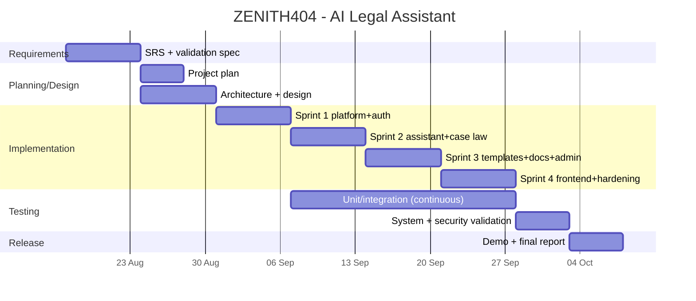

# Jackfruit Phase-2: Project Plan Document

## 1. Lifecycle model - Agile (Scrum, 1-week sprints)
Chosen because the course mandates Agile, requirements around the LLM/knowledge base will keep changing as we
test answers, and each member owns a vertical slice that can be demoed every sprint. Short sprints give weekly
evaluable increments; a living backlog absorbs change; CI gives fast feedback.

## 2. Tools
| Purpose | Tool |
|---|---|
| Planning / backlog / bug tracking | GitHub Projects + Issues (templates in `.github/ISSUE_TEMPLATE`) |
| Version control | Git + GitHub (feature branches, PR review required) |
| Design | draw.io / Mermaid (diagrams in `04_Architecture_and_Design.md`) |
| Development | Python 3.12, FastAPI, SQLAlchemy, PostgreSQL; React + Vite |
| Testing | pytest, pytest-cov, FastAPI TestClient |
| Static analysis / security | flake8, bandit, SonarQube |
| CI/CD | Jenkins (`Jenkinsfile`) and GitHub Actions (`.github/workflows/ci.yml`) |
| Containerisation | Docker, docker-compose |

## 3. Deliverables: reuse vs build
| Component | Decision | Justification |
|---|---|---|
| FastAPI, React, PostgreSQL, SQLAlchemy | Reuse | Mature, well documented |
| bcrypt, PyJWT | Reuse | Never hand-roll crypto |
| pypdf, python-docx | Reuse | Standard text extraction |
| External LLM API | Reuse | Training an LLM is out of scope |
| Domain classifier | Build | Needs project-specific domains; transparent and testable |
| Keyword retrieval | Build | Simple, explainable; SRS excludes semantic search |
| Prompt/safety layer | Build | Core to our safety requirements |
| Knowledge base content, templates | Build | Domain curation is our value-add |
| Admin tools, feedback, UI | Build | Application-specific |

## 4. Work Breakdown Structure
1. **Requirements** - 1.1 elicitation, 1.2 SRS, 1.3 validation spec
2. **Design** - 2.1 architecture, 2.2 ER/class design, 2.3 API definition, 2.4 UI wireframes
3. **Implementation**
   - 3.1 Platform: repo, CI, Docker, DB models, config
   - 3.2 Auth & security: registration, login, JWT, RBAC, throttling
   - 3.3 Assistant: validation, classifier, retrieval, LLM service, safety filter, history/follow-ups
   - 3.4 Case law search
   - 3.5 Templates: list, search, fill, download
   - 3.6 Documents: upload validation, extraction, analysis, privacy
   - 3.7 Feedback
   - 3.8 Admin: KB CRUD, templates CRUD, feedback review, users
   - 3.9 Frontend: shell/login, chat, case law, templates, documents, admin
   - 3.10 Knowledge base seeding
4. **Testing** - 4.1 unit, 4.2 integration, 4.3 system/manual, 4.4 security (bandit, authz tests), 4.5 performance
5. **Release** - 5.1 Docker packaging, 5.2 demo, 5.3 final report, 5.4 maintenance plan

## 5. Effort estimate (person-months; 4 people, ~4 calendar weeks)
| WBS | Task | PM |
|---|---|---|
| 1 | Requirements | 0.25 |
| 2 | Design | 0.25 |
| 3.1 | Platform | 0.15 |
| 3.2 | Auth & security | 0.15 |
| 3.3 | Assistant | 0.35 |
| 3.4 | Case law | 0.10 |
| 3.5 | Templates | 0.15 |
| 3.6 | Documents | 0.20 |
| 3.7 | Feedback | 0.05 |
| 3.8 | Admin | 0.20 |
| 3.9 | Frontend | 0.30 |
| 3.10 | KB seeding | 0.10 |
| 4 | Testing | 0.30 |
| 5 | Release & docs | 0.20 |
| | **Total** | **2.75** |

(Adjust to your real timeline and calendar dates.)

## 6. Schedule (Gantt)

(Dates are placeholders - shift them to your semester calendar.)

## 7. Sprint plan
| Sprint | Goal | Stories |
|---|---|---|
| 1 | Walking skeleton | Repo+CI+Docker, DB models, register/login, JWT, RBAC |
| 2 | Core Q&A | Validation, classifier, retrieval, LLM+fallback, case law search |
| 3 | Content features | Templates, uploads/analysis, feedback, admin APIs |
| 4 | UI + quality | React screens, system tests, security fixes, docs, demo |

## 8. Risks
| Risk | Mitigation |
|---|---|
| LLM downtime/cost | Deterministic fallback; configurable timeout |
| Hallucinated law | Retrieval-constrained prompt, out-of-scope fallback, safety filter, disclaimers |
| Outdated KB content (e.g. CrPC -> BNSS) | Admin editing tools; review KB each sprint |
| Uneven contributions | One owner per feature; PR reviews; commit checks |
