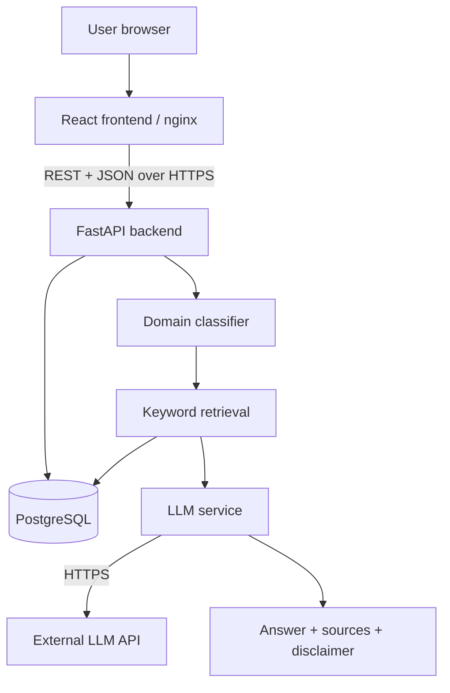
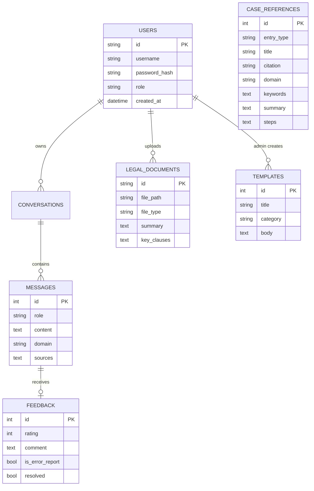
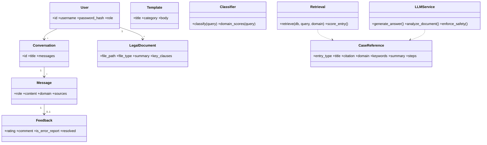
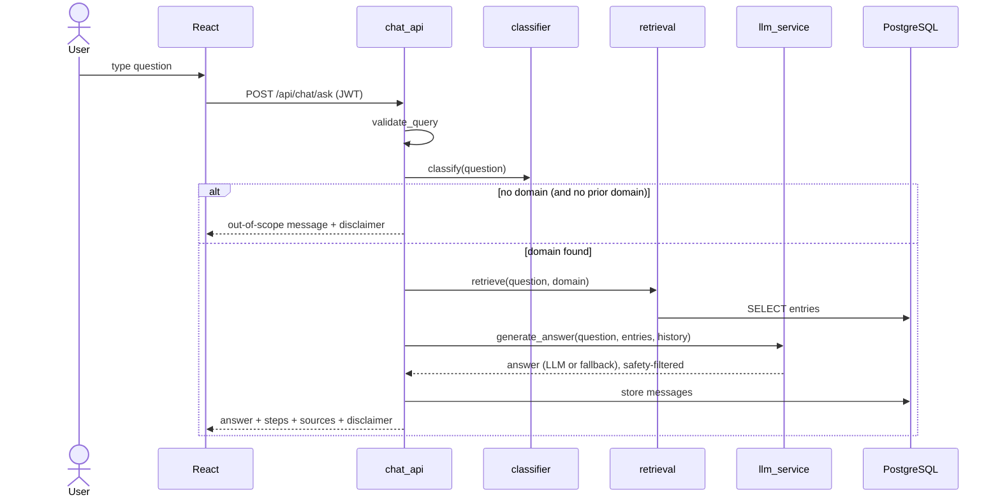

# Architecture and Design

## 1. High-level architecture

## 2. Modules and responsibilities
| Module | File | Responsibility |
|---|---|---|
| Config | `config.py` | Env-driven settings, disclaimer and out-of-scope text |
| Persistence | `database.py`, `models.py` | SQLAlchemy engine, ORM models |
| Security | `security.py`, `deps.py` | bcrypt, JWT, throttling, auth + RBAC dependencies |
| Auth API | `auth_api.py` | Register, login, profile, erasure |
| Chat | `chat_api.py` | Validate -> classify -> retrieve -> generate pipeline, history |
| Classifier | `classifier.py` | Weighted-keyword domain routing |
| Retrieval | `retrieval.py` | Keyword scoring over knowledge entries |
| Generation | `llm_service.py` | Prompt build, LLM call, fallback, safety filter, document analysis |
| Case law | `case_law_api.py` | Search by keyword/jurisdiction/citation |
| Templates | `template_api.py` | List, placeholders, fill, TXT/DOCX download |
| Documents | `doc_analysis.py` | Upload validation, extraction, analysis, owner-only access |
| Feedback | `feedback_api.py` | Ratings / error reports |
| Admin | `admin_kb.py` | KB, templates, feedback, users |
| Seed | `seed.py` | Starter knowledge base, templates, admin |

Stages are decoupled (SRS 6.4): swapping the classifier for an ML model, retrieval for embeddings, or the LLM
provider only touches one file.

## 3. Entity-relationship diagram

## 4. UML class diagram (simplified)

## 5. Sequence: asking a question

## 6. REST API (ABI/API definition)
All routes are under `/api`; JSON unless noted; `Authorization: Bearer <JWT>` except register/login/health.

| Method & path | Purpose | Req |
|---|---|---|
| POST `/auth/register`, `/auth/login` | Account and token | FR-01 |
| GET `/auth/me`; DELETE `/auth/me/data` | Profile; erase my data | 6.3 |
| POST `/chat/ask` | Ask / follow-up | FR-01..08, 10 |
| GET `/chat/conversations[/{id}]`; DELETE `/chat/conversations/{id}` | History | FR-10 |
| GET `/case-law?q&jurisdiction&citation&limit` | Case search | FR-09 |
| GET `/templates?q&category`; GET `/templates/{id}`; POST `/templates/{id}/fill?fmt=txt\|docx` | Templates | FR-11, 12 |
| POST `/documents` (multipart); GET `/documents[/{id}]`; DELETE `/documents/{id}` | Upload/analyse | FR-13, 14 |
| POST `/feedback` | Rate/report | FR-15 |
| `/admin/references`, `/admin/templates` (CRUD) | KB + templates | FR-16, 17 |
| GET/PUT `/admin/feedback` | Review feedback | FR-18 |
| GET `/admin/users`; PUT `/admin/users/{id}/role`; DELETE `/admin/users/{id}` | Users | FR-19 |
| GET `/health` | Liveness | - |

Interactive docs: `http://localhost:8000/docs` when the backend runs.

## 7. Key design decisions
- **Constrained generation:** the prompt contains only retrieved entries; if retrieval is empty the system says it has no reference instead of calling the LLM.
- **Safety:** `enforce_safety` post-filters every model output; disclaimer attached by the API, not the model.
- **Security:** bcrypt, JWT with 30 min expiry, per-username lockout, RBAC dependency, owner checks (404 not 403, to avoid leaking existence), upload validation (extension + magic bytes + size, server-chosen filenames), LIKE-wildcard escaping, security headers, non-root container.
- **Follow-ups:** an unclassifiable follow-up inherits the previous assistant domain and augments retrieval with the previous question.
- **Portability:** SQLite for tests/dev, PostgreSQL in compose, via one `DATABASE_URL`.

## 8. UI/UX
Single-page React app with tabs: Ask, Case law, Templates, My documents (+ Admin for admins). A permanent banner states the tool is informational only; each answer shows sources, steps and the disclaimer; errors appear inline. Colours respect light/dark mode.

## 9. Division of work
See ownership table in `02_Synopsis.md`; each owner also writes the tests for their modules.
